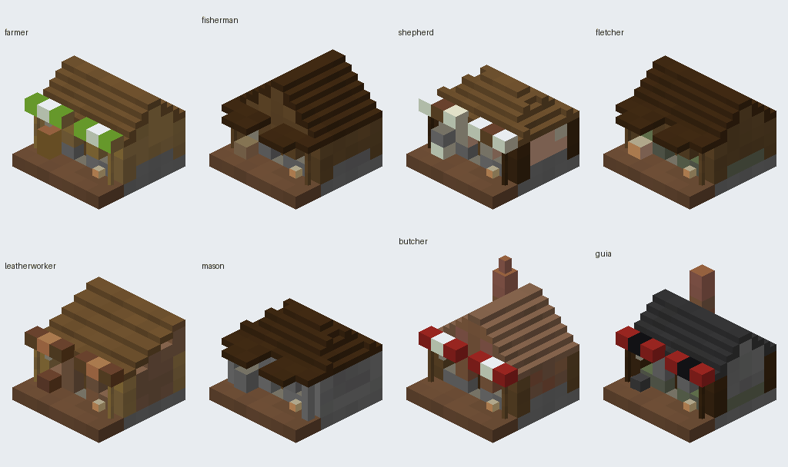
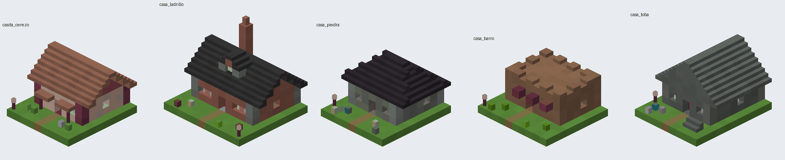
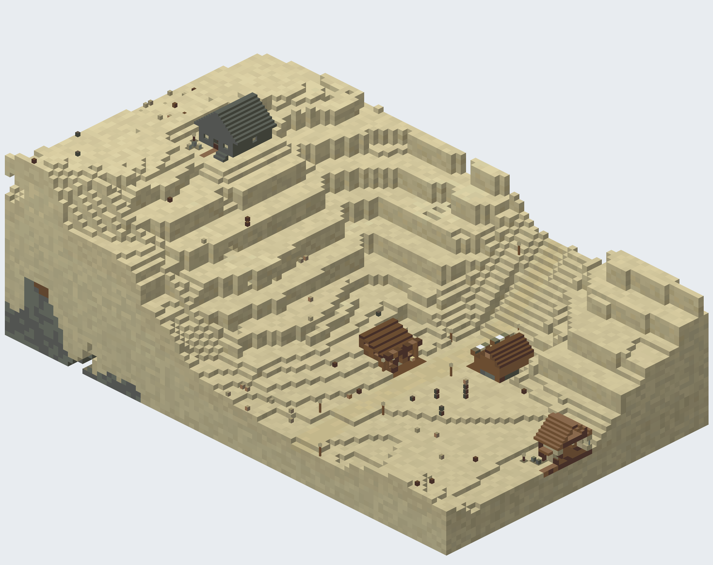
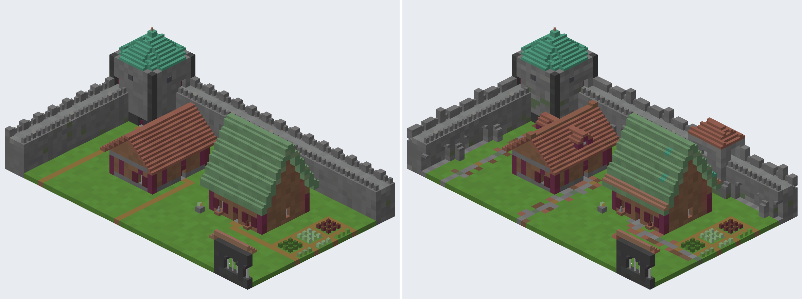

# Design pass, phase 2: round the town, every building its own

Phase 1 dealt with the ground and the skyline. This one deals with repetition round the town, the part of the diagnosis
(1.1, point 6) that needs no decision from the owner: the roadside huts were one flat-roofed cube with eight awning
colours, the grounds houses one gabled box in five materials (`diagnosis/06_spawn_huts_and_houses.png` is the before).

| | |
|---|---|
| The eight roadside huts |  |
| The five grounds houses |  |
| On the owner's seed: the north road, two huts, two houses |  |
| The town's door lanes (plain, dressed) |  |

- **Huts.** The same plan in all eight (the Java side places the door, bed, workstation and bell by position), under
  its own walls (planks, logs laid as a cabin, white daub, mud brick, stone, brick, cobble), its own roof (a gable along
  the road, a gable end to the road, a hip, a single slope), a striped awning or a slab porch, and something of the
  trade on the porch (hay, a target, wool, dried kelp, an anvil). Two get a chimney stack (no fire in it). The template
  grows from 6 to 9 blocks high; its footprint and every position the blueprint names stay.
- **Houses.** A gable with a porch either side of the door; a gable with a dormer and the chimney; a hip; a terrace
  behind a parapet with beams out front; a gable end to the yard. Same footprints, same slots.
- **Lanes.** The one-block dirt threads from each door to its street become a worn cobble mix with a verge that fades
  into the grass in patches.

A mistake caught by an existing test, worth knowing: my first porches covered the cell in front of the door, and
`doors.template_report` skips a door whose way out is under a cover, so the door rule silently stopped checking those
doors (the grounds' own test failed; the huts had no such test and passed). Every porch now leaves the door's column
under the open sky, and the huts have the same test.

Cost: only blocks. No entity, block entity or light source added (two lanterns a hut, as before). The town build, roads
and grounds measured the same as phase 1 (2,286 ms, 133 ms and 203 ms on the server thread).
