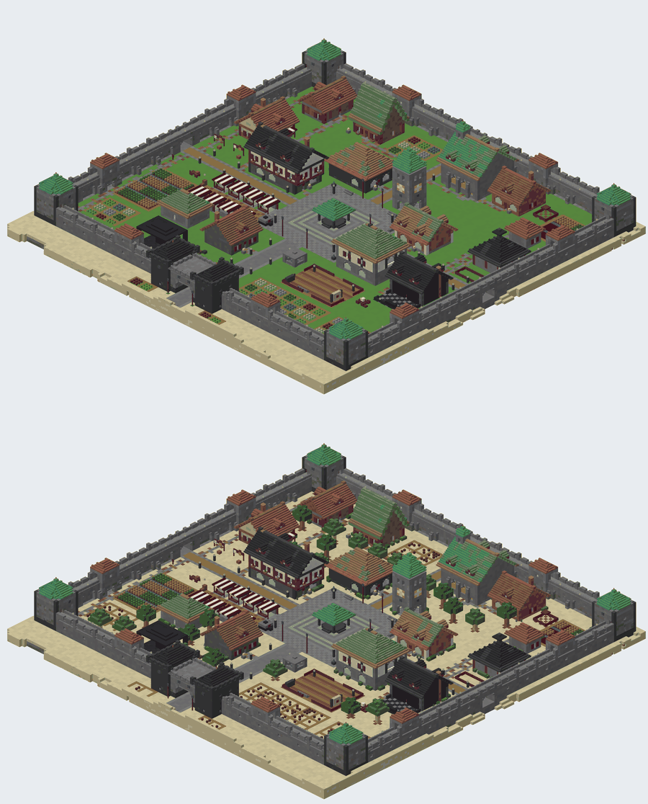
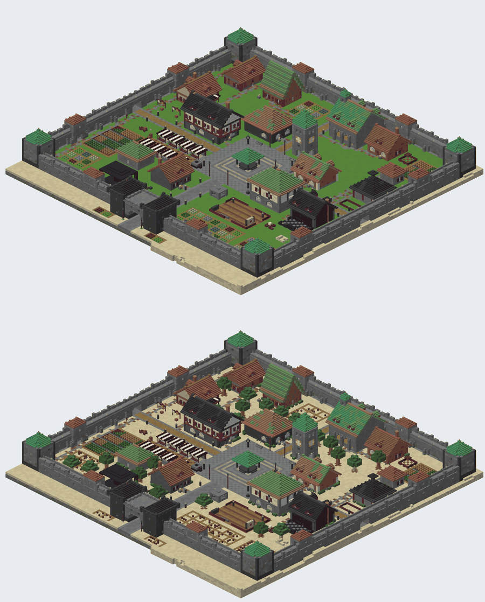
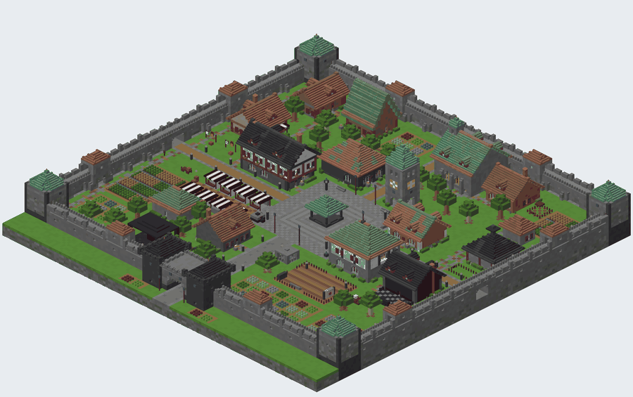

# Design pass, phase 2b: inside the wall

The owner's answers to the diagnosis's open questions, for the Herald's House: the ground inside the wall changes with
the land (no green oasis behind the wall), real trees inside the town with the fire question solved rather than avoided,
hedges and potted plants.

| | |
|---|---|
| The site the game picks on the owner's seed (48 86 0, a new world left to itself): before, after |  |
| The site `herald_steep.py` forces on the same seed (steep, a pond across the wall): before, after |  |
| On grassland (the template itself) |  |

- **Ground.** Off grassland, the template's lawn takes the land's own surface when each chunk's part of the town is
  placed: sand, red sand, gravel or mud, as the margin outside the wall already did (`Building.interior`, the commonest
  land of the margin). What grows keeps its soil: the crops their farmland. On sand a flower has nothing to live on, so
  a flower bed becomes a dry garden: bare sand, a dead bush in one bed of three. On grassland nothing changes. Read
  back from the saved world on the steep site: 6,290 of 10,151 open ground columns inside the wall were grass (62 %),
  56 of 10,199 are (0.5 %); the test fails with the build of phase 2.
- **Trees.** 24 oaks and birches, 6 to 8 blocks tall, on the widest lawns: where the grass is bare 3 blocks round the
  trunk, the roomiest places first, none within 8 blocks of another. Each stands in a pit of rooted dirt ringed with
  coarse dirt, so that it has soil when the lawn is sand.
- **Fire.** Trees burn, as trees do; the town does not. `herald_house.fire_errors` (the model of lightning and fire
  spread that already guarded the bookshelves and carpets) runs with the trees in and reports nothing: no block that
  burns indoors is within reach of a fire in a tree or a hedge. Wood and leaves are still an error anywhere but where
  the planting put them. A test puts a carpet under a crown and the rule reports it.
- **Hedges and pots.** One block of leaves against a building's wall, in runs with gaps, on grass more than 2 blocks
  from every path, lane and door's way out; a potted plant in one place of six. The runs that the fire rule finds
  carrying fire to something that burns indoors are taken out again until it reports nothing: 187 hedge blocks and 45
  pots are left.

Nobody's walk changes: `herald_house.errors` (walks to bed, workstation and bell; the door rule; look-don't-take) passes
unchanged. Only blocks: no entity, block entity or light source added.

A hedge is a step of one block, and a villager that gets to where it cannot come down from loses its bed (measured on a
server for the hunters' lodge: a drop of more than 3 blocks is a trap). So a test walks the template from the spawn
point (a step up of one block, a drop of at most three, leaves as solid ground): with the planting 15,859 cells are
reached and none is without a way back, and nothing above a hedge's top is reached that was not reached without the
planting. What that shows and what it does not: it is a model of steps, not the game's path search; it says a hedge
leads nowhere, and nothing about ladders or pushing, of which this phase adds none.

## Cost

In play (what the owner cares about most): `runtime_cost.py --scenarios casa_heraldo`, one player inside the town, 60 s
measured, two rounds alternated on one machine, 20.0 TPS throughout. With Heraldia, ms per tick:

| | mean | p50 | p95 | p99 | worst |
|---|---|---|---|---|---|
| phase 2, round 1 | 11.1 | 10.7 | 15.1 | 18.1 | 33.0 |
| phase 2b, round 1 | 10.4 | 9.9 | 14.5 | 18.3 | 45.5 |
| phase 2, round 2 | 10.0 | 9.8 | 13.3 | 16.1 | 29.2 |
| phase 2b, round 2 | 9.1 | 8.6 | 12.7 | 15.6 | 32.2 |

No measurable change: the two builds differ by less than one build's two rounds do. The 45.5 ms tick of round 1 did
not come back in round 2. The same scenario **without the mod** gave worst ticks of 30.8, 18.3 and **81.8 ms** on that
machine (with a mean of 7.8): the machine alone produces a single worse tick than that one, so a lone worst tick says
nothing here.

Creating the world (a new world's first start; it matters less to the owner): the longest TEMPLATE step of the town's
build was 76 to 143 ms on `develop` (8 runs) and 86 to 130 ms here with one run at 279 (7 runs): the ranges overlap. The
279 is probably the JVM building its first villager inside that step (found by the work on the build's slow steps: 76 ms
the first time, 1 ms the second); not checked on this branch. The 64 TEMPLATE steps together take more, about 1.8 s against 1.4 s (medians; there are more blocks
to place). The ground's own part of those steps is 9 to 14 ms in all.
