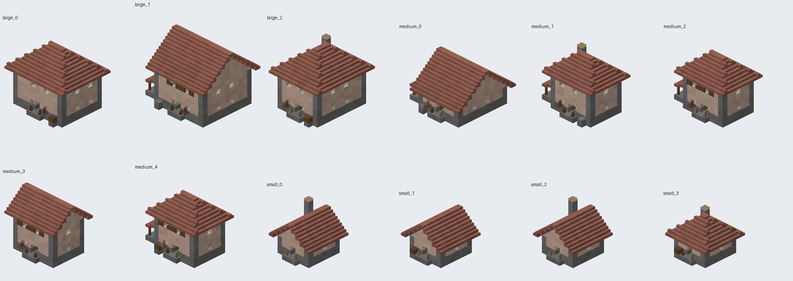
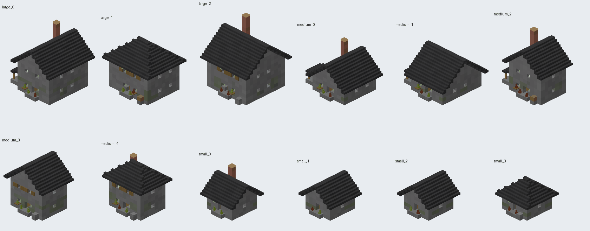
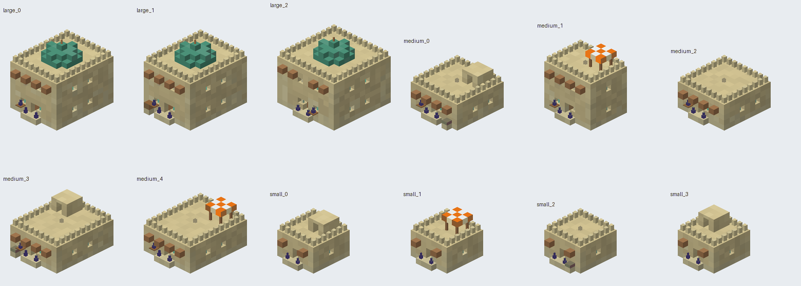
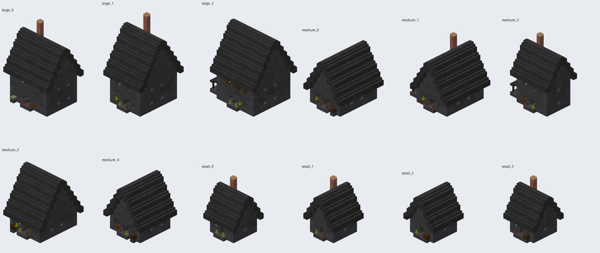

# Design pass, phase 3 (first step): the houses of a village style are not one house

The diagnosis (1.3, point 1): inside a style, the twelve houses were one symmetric box with one roof
(`diagnosis/07_village_houses_one_style.png` is the before, for `llanuras_castellana`). This step varies them inside the
footprints the jigsaw already uses: no pool, weight, bed slot, door or interior moves.

| | |
|---|---|
| `llanuras_castellana` |  |
| `llanuras_gallega` |  |
| `desierto_andalusi` |  |
| `oscuro_gotica` |  |

- **Roof.** The style's own material and kind, but not the same on every house: about a third of a hip style's houses
  get a gable and a fifth of a gable style's a hip; on near-square houses the ridge runs along the street or across it
  (a gable end to the street). Chimneys on hips too, ending two blocks over the roof where they come through.
- **Dormers** on some single-storey gables at least nine wide.
- **Flat roofs** (the desert and badlands styles): a roof room in a back corner, a wool shade on four posts, or the bare
  terrace, by the house's number so the houses of one size never all get the same.
- **Walls.** Stone walls weather in patches: damp low (mossy, cobbled), cracks high. Wood, plaster and glass stay.
- **By the door.** Half the houses leave a stack of firewood or cut stone beside the step.

Counted, not asserted (`tests/test_houses.py`, every style): 32 of the 36 styles now show at least 8 different skylines
among their 12 houses and at least 2 among their 4 small ones (before: the four small ones were identical in every
style). The four styles whose shape is their own are not varied yet and keep a lower floor in the test: the round huts
(`sabana_paja`, 3), the pagodas (`cerezos_japonesa`, `cerezos_templo`) and the long houses (`taiga_nordica`).

Not done, and why: asymmetric plans (an L, a lean-to that changes the footprint, a jetty) move the bounding box the
jigsaw places and need the generation-cost test and the owner's word on how far a style may change (decision 4).
