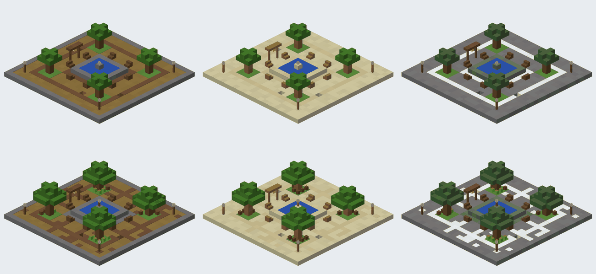
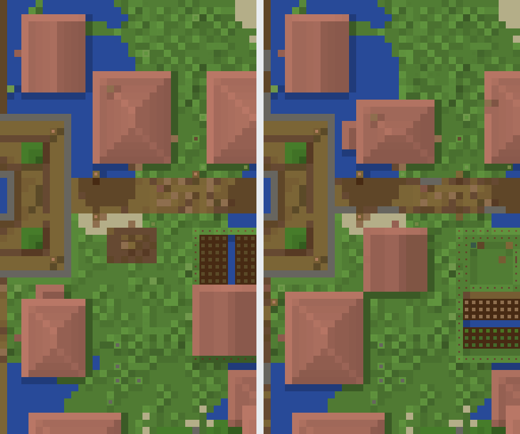

# Design pass, phase 4, first step: a village's streets and its plaza

The diagnosis (1.3, point 4): "streets and plazas are bare. A street piece is a strip of path; the plaza is a ring of
path round a fountain with four trees."

| | |
|---|---|
| The plaza in three styles (plains, desert, snow): before (top), after (bottom) |  |
| An avenue leaving the plaza, in a world: before (left), after (right) |  |

- **Streets.** A kerb along both edges: the style's second paving and, in runs of three, its stone. Flush with the
  ground: nothing to step over, and a crossing has none. Beside the lamps, four things one block wide: a bench, a
  woodpile, a bale of hay, a milestone. None is a container, a light or anything a villager takes for a workstation.
- **Light.** Lamps keep 7 parts in 13 of a street's decoration slots, as before: the new things took the place of
  empty slots and of one of the planter's two. A street is as lit as it was.
- **Plaza.** Same size, same fountain, same four avenues, and every position the village's welcome decorations use
  left as it was. New: a step of the style's stone round the fountain; the lines of the four avenues drawn in the paving
  up to it; in each corner a bed of the style's flowers under a tree with a real crown (4 or 5 blocks of trunk, a 5 x 5
  crown). A style whose plants only live in a pot, or prick (cactus, bamboo, sweet berries), gets a dead bush or a fern
  in its beds.

What the pictures show honestly: the plaza is visibly richer; the kerb is discreet (it reads close up, hardly at the
scale of a whole village); the street's things are single blocks and the woodpile and the hay are the plainest of them.
The second picture is of a village placed by command, which does not fit the terrain: it is there for the street, not
for how the village sits.

In new chunks a village of the same style and seed is laid out differently (other houses in other places), as with
every change to a village's pieces. A village already generated stays as it is.

Only blocks: no entity and no block entity added; 144 small templates more (four per style).

## Cost

Generating (`generation_cost.py`, two rounds, `develop` then this branch and the other way round, one machine):

| | `develop` | this branch |
|---|---|---|
| overhead against vanilla (reference +9.3 %, limit +19.7 %) | +9.0 %, -1.0 % | +9.2 %, +7.0 % |
| chunks over 50 ms, without → with the mod (limit +6 points) | +1.2, +0.2 points | +1.9, +0.1 points |
| worst stretch, ms per chunk | 52, 57 | 51, 58 |
| tick time p99 while generating (limit 50 ms) | 2.9, 10.6 ms | 10.2, 7.8 ms |

No signal: on every row one build's two rounds are further apart than the two builds are. The worst chunk with the mod
is the same one in all four runs (the village's own, 760 to 930 ms, most of it `structure_starts` and `terrain`), on
`develop` as on this branch.

Villagers' routes (`village_routes.py`, the 8 villages and the 3 hard ones, one run each): the sample moved before
this change and moves again with it (the limits were measured on 107 villagers; `develop` today places 104, this
branch 100). No sign that the routes break; with one run a side and different samples, no claim that they are better.

| 8 villages | villagers | moving | commute | asleep | with a bell | same house |
|---|---|---|---|---|---|---|
| `develop` | 104 | 93 (+4) | 45 (+3) | 64 (+12) | 79 (+11) | 20 (+0) |
| this branch | 100 | 92 (+7) | 50 (+10) | 65 (+15) | 74 (+9) | 14 (+6) |

| 3 hard ones | villagers | moving | commute | asleep | with a bell | same house |
|---|---|---|---|---|---|---|
| `develop` | 39 | 36 (+2) | 20 (+4) | 26 (+6) | 28 (+2) | 7 (+0) |
| this branch | 36 | 31 (+0) | 19 (+4) | 22 (+4) | 27 (+3) | 4 (+3) |

(In brackets, the margin over each limit in villagers. No limit is changed.)

Not measured: the cost of generating while a player explores (the scenario for it is being built).
