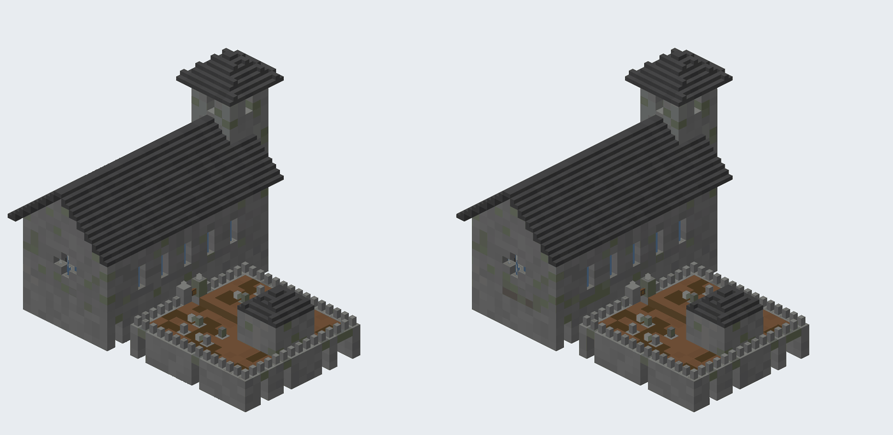
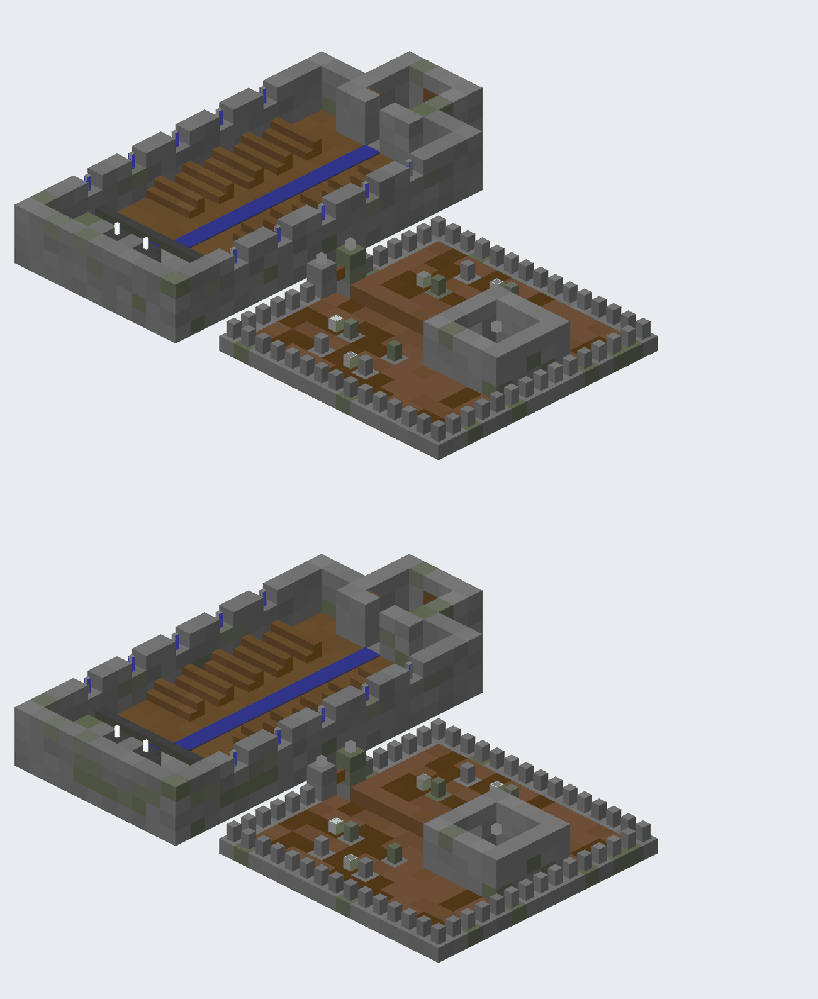

# Design pass: the wear the owner approved

The diagnosis proposed, as its question on wear: **"lived in, not abandoned": moss and cracks low and by water, never
holes.** The words are the design session's own; the owner approved the proposal as it stood (relayed by the
orchestrator, not quoted from him).

`houses.weather_outside` applies it to the stone of a village's special buildings (church, town hall, market, tavern,
inn, smithy, library, mill): of the blocks that face the open air in the two courses above the ground, and up to the
fourth course within two blocks of water, some become their kin in patches, mostly the damp one, a few the cracked
one. A block only ever becomes another full block of its own stone. Indoors, the ground course and everything above
those courses are left as they were. The styles of wood and plaster have nothing to wear.

## Where the new wear meets the one the world already had

In eight families (forest, dark forest, swamp, jungle, plains, snow, coast, taiga) a village's building processor
already turns 12 % of the cobblestone and of the stone bricks mossy, and 6 % of the stone bricks cracked, anywhere on
the building, as the village generates. There the two add up. This is a church of one of them (`nieve_fortaleza`)
**as generated in a world** with both: before on the left, after on the right.

And the same church cut at its two lowest courses, with its graveyard: before on top, after below. This is where the
change is.

Counted in that world: in the first course above the ground, 13 of 113 stone blocks were worn (11 %) and 25 of 113 are
(22 %); in the whole church the mossy blocks go from 124 to 147 of about 1,400 stone blocks, and the cracked ones stay
at 22.

What the pictures show honestly: the wear is low and discreet, as asked. From afar the building reads the same; close
to its foot there is about twice the moss.

## A first version that was not what had been approved

It put the cracks high on the wall (as the houses of phase 3 do: "damp low, cracks high"). Counting the blocks of a
generated church showed what that meant: cracked bricks from 22 to 94, a quarter of all its stone bricks, and hardly
any more moss. The approved proposal says "low and by water", so the wear is now only there.

The houses of phase 3 (`houses.weather`, merged before his answer) still crack high on the wall. Whether to bring them in line with this
is not decided here: it would change every house.
